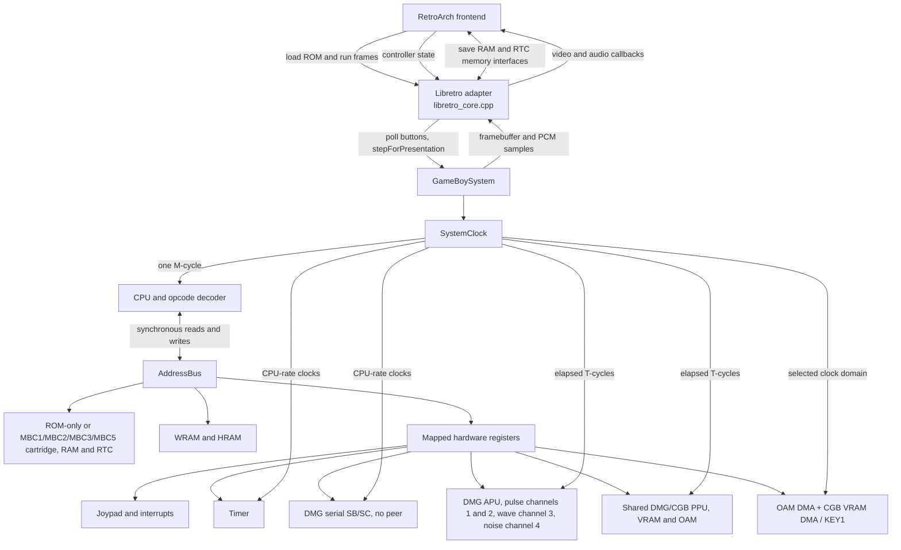
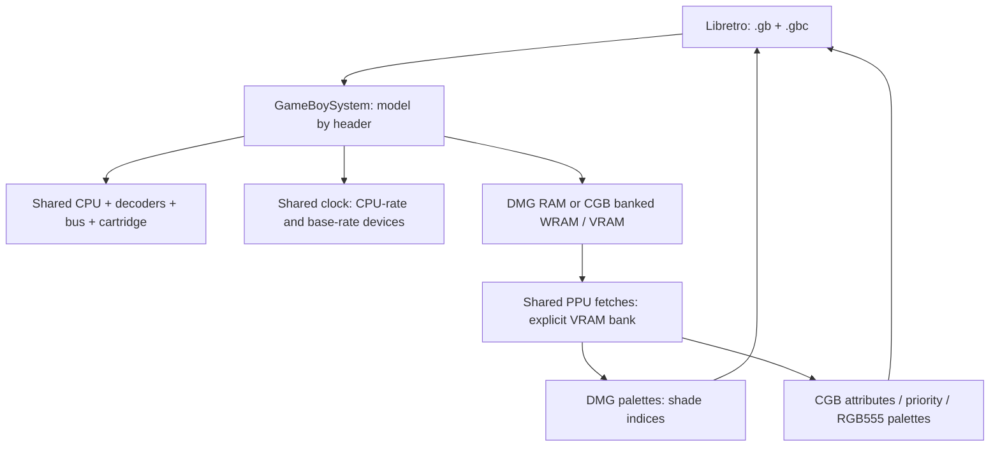

# Current architecture and development workflow

This guide describes the implemented runtime boundaries, not a target design.
Work priorities live in the [roadmap](roadmap.md); feature evidence and known
limits live in the [DMG validation matrix](dmg-validation.md) and
[CGB implementation guide](cgb-development.md).

## Current scope

LotusGB composes DMG and native CGB systems behind one libretro adapter. The system
composes the CPU, address bus, cartridge and RAM, timer, interrupts, joypad,
unconnected serial port, PPU, OAM DMA and APU. The default startup profile
selects DMG or CGB from cartridge header bit 7 and skips boot-ROM execution;
an optional external DMG boot ROM can be selected for DMG startup. Native
CGB uses its own synthetic post-boot registers/palettes without a BIOS. ROM-only, MBC1, MBC2, MBC3
and MBC5 cartridges are supported within the limits listed in the validation
matrix.

The PPU renders background, window and object pixels and implements selected
mid-scanline register behavior. Its Mode 3 BG/OBJ fetch arbitration and some
raster timing remain approximate. The [PPU guide](ppu-scrolling.md) records the
current DMG model and visual evidence. The same renderer supports CGB color
attributes, palettes, flips and priority, while timing remains approximate.
Additional mapper families, connected serial peers and MBC5 rumble output
remain outside the current implementation. The external boot ROM is user-supplied and is not included in
the repository.

## Runtime flow

`retro_run()` polls input, advances to the next presentation boundary or
bounded repeat, then submits video and audio. `SystemClock` asks the CPU to
execute one M-cycle and advances devices at the bus phase before dispatching
memory accesses. An M-cycle contains four CPU clocks: four base clocks at
normal speed or two at CGB double speed. Timer/serial/OAM DMA receive CPU
clocks; PPU/APU/VRAM DMA receive base clocks. Without a bus access, devices
advance after the CPU step. The APU frame sequencer uses DIV bit 12 falling
edges at normal speed and bit 13 at double speed, including DIV resets.
A zero-time CPU step does not advance devices; explicit DMA idle/speed-pause
steps advance the selected clock domains while CPU execution is stalled.

The core API `stepFrame()` advances at least 70,224 base T-cycles in whole M-cycles. For event-based tests,
`stepUntilVBlank()` waits for a PPU frame-completion notification at
actual VBlank entry, with an explicit cycle budget and incomplete result for
LCD-off timeout or STOP. The notification is host bookkeeping excluded from
snapshots, reset before each M-cycle; it does not change hardware state or the
save-state format. Readable LY alone is insufficient because it changes four
dots before actual VBlank. See the [input-phase diagnosis and test builds](input-latency.md#vblank-stepping-and-fixed-step-diagnostics).

VBlank stepping changes the return boundary, not the shared clock: CPU,
timer, APU, PPU and DMA still advance together. PCM quantity follows elapsed
hardware time, while the frontend schedules callbacks and playback. During
repeated LCD restarts a video call need not advance one nominal frame of
hardware time. The [headless pacing assessment](input-latency.md#headless-pacing-and-rewind-assessment-2026-11-01)
keeps that distinction explicit. The ordinary libretro adapter now calls
`stepForPresentation()`: a real completion or a bounded healthy Repeat can
end a call, while CPU STOP and failure remain distinct results. A Repeat is a
host presentation event and never creates a guest interrupt. The fixed-step
build remains available for diagnostic comparison.

DMA is a separate bus master. `AddressBus::read()`/`write()` advance to the CPU
bus phase and then consult the borrowed `ICpuBusArbiter`. The DMA device uses
`readForDma()` to dispatch source reads without re-entering CPU timing or CPU
arbitration. FF46 schedules a transfer; the shared clock moves one byte per
M-cycle after the startup delay. CPU OAM reads return `$FF` while DMA owns OAM;
HRAM and I/O remain accessible, including FF46 for restarting the transfer.
The basic DMG conflict model distinguishes VRAM from the shared cartridge/WRAM
bus: CPU reads on the occupied bus see the latest DMA byte, and CPU writes to
that bus are discarded. Write-induced corruption and PPU/DMA rendering
contention are not implemented. This is DMG behavior, not a CGB bus model.

The PPU applies its own mode-based VRAM/OAM access restrictions at the bus
boundary. In LotusGB's DMG model, a denied read returns `$FF` and a denied write
is discarded immediately; the CPU does not wait for the next accessible mode,
and the write is not replayed later. Games schedule updates around these windows
by polling LY/STAT or using their interrupts. A system-level CPU test exercises
that pattern: it verifies rejected Mode 3 writes do not stall or replay, then
confirms updates succeed after software polls to Mode 0. The exact
transition-dot behavior remains a separate PPU timing question.

`GameBoySystem` owns the hardware components. `AddressBus` routes CPU accesses to mapped regions and borrows those regions; the system keeps them alive. RetroArch callbacks and lifecycle handling stay in the libretro adapter, outside CPU and hardware components. The adapter catches exceptions during `retro_run`, logs the failure, and leaves emulation faulted until reset or content reload so a C++ exception cannot escape the libretro callback.

## Save-state boundary

`GameBoySystem` exports/imports versioned value-only snapshots between M-cycles.
`StateCodec` validates a separate candidate before committing, preserving live
references, callbacks and published cartridge storage addresses. Libretro owns
the file/slot interface and contains exceptions. See [save states](save-states.md)
for the schema, version policy, RTC behavior and validation scope.

Native CGB snapshots use version 2/model 2, retaining the v1 base component
sections and appending banked RAM, color palettes/buffers, fetch metadata,
VRAM DMA and speed-switch state. Clock domains are rebound from validated
speed state after loading. DMG version 1 field order remains unchanged. The
synthetic LCD-off boot probe remains a separate test-only configuration.

## Shared GB/CGB composition

One `GameBoySystem` owns CPU, decoders, bus, cartridge and clock for playable
DMG and native CGB. There is no second CPU or frontend runtime. Public explicit
model construction supports the headless tests; libretro chooses the model
from the header, independently of the `.gb`/`.gbc` extension. `DmgBootRom`
remains a source alias for the generalized `BootRom`.

| Boundary | Shared behavior and model differences |
| --- | --- |
| CPU / decoding | Same instruction engine. KEY1-armed STOP is coordinated by the system, with a clocked pause before changing rate and waking the CPU. |
| Bus / cartridge | Same dispatcher, aliases and mappers; composition selects RAM/register mappings and adds CGB VRAM DMA. OAM DMA bus conflicts remain approximate. |
| Clock / timer / audio / serial | A CPU M-cycle advances 4 CPU clocks, corresponding to 4 or 2 base clocks. Timer/serial/OAM DMA use the CPU domain; PPU/APU/VRAM DMA use base time. APU divider tap follows CPU speed. |
| Startup / RAM | Separate synthetic handoffs and optional CGB banked storage. No selectable DMG compatibility mode on CGB; DMG games use DMG hardware. |
| PPU | Same timing/fetch/render pipeline uses owned DMG VRAM or borrowed `IVideoRam`. CPU windows precede selected-bank storage access. Color mode adds banked attributes, palettes and OAM-order priority; DMG keeps existing shade behavior. |
| Frontend / snapshots | Both pixel formats convert RGB555 or DMG shades. Snapshots preserve v1 DMG and use v2 for CGB, with atomic candidate validation and stable SRAM/RTC pointers. |

The system owns external video storage, which outlives the PPU and is shared
directly; no VRAM synchronization copy is needed. The borrowed pointer and
callbacks are wiring, excluded from snapshots. Native CGB serial, DMA and
speed-transition edge timing still have narrower coverage than the playable
DMG path. Exact contracts, tests and remaining scope live in the
[CGB guide](cgb-development.md).

## Main code boundaries

| Area | Location | Responsibility |
| --- | --- | --- |
| CPU and instruction execution | `src/lib/GBCPU.cpp`, `src/lib/decoder.cpp`, `src/lib/instSubFunc*.cpp` | Execute instructions in M-cycle steps and report memory accesses, flags, and CPU state. |
| System composition and clock | `src/lib/game_boy_system.cpp`, `src/lib/system_clock.cpp` | Own and connect hardware, initialize the default post-boot profile, and advance components from CPU time. |
| Memory and hardware | `src/lib/address_bus.cpp`, `src/lib/cartridge.cpp`, `src/lib/memory_region.cpp`, `src/lib/timer.cpp`, `src/lib/dmg_apu.cpp`, `src/lib/dmg_ppu.cpp`, `src/lib/dmg_oam_dma.cpp` | Implement mapped memory regions, ROM-only/MBC1/MBC2/MBC3/MBC5 cartridges, cartridge RAM, and DMG devices. |
| PPU video storage | `src/lib/include/video_ram.hpp`, `src/lib/cgb_memory.cpp`, `src/lib/dmg_ppu.cpp` | Separate selected-bank CPU storage access from explicit-bank PPU fetches, while the PPU owns CPU access windows. |
| Frontend adapter | `src/libretro/libretro_core.cpp` | Load supported content, poll RetroArch input, run frames, contain runtime exceptions, and deliver video/audio callbacks. |
| Tests and test ROMs | `src/unit_test/`, `tests/roms/` | Check observable component, system, rendering, and frontend behavior. |

## Development workflow

1. Pick a bounded behavior from the [roadmap](roadmap.md) and state what an external observer should see: registers, flags, cycles, memory accesses, interrupts, pixels, audio samples, or input response.
2. Check the relevant hardware reference and existing test ROMs. Record model and boot assumptions when a ROM depends on them.
3. Add a focused regression at the narrowest useful boundary, then implement the behavior in its owning CPU or hardware component. Keep frontend-specific code in the libretro adapter.
4. Run the [standard testing workflow](testing.md). Use GBIT or a targeted ROM when it covers the changed behavior; investigate disagreements against hardware behavior.
5. Update the roadmap when milestone status, known limits, or implementation order changes. Update this document when ownership or runtime flow changes.

`make test` covers the in-repository unit and libretro adapter tests. GBIT integration is a separate check; use the [testing workflow](testing.md) and the CI workflow's pinned revision.

## Refactoring guideline

- State the externally visible behavior or invariant before changing structure. Make one small structural change at a time and keep it behavior-preserving; handle emulation behavior changes separately.
- Give a function or component a clearer owner only when that improves naming, state ownership, or a useful test boundary. File length or a design-pattern name alone is not a reason to add an abstraction.
- Keep the start, advance, and completion of a clocked operation under one owner. Return whether the operation occupied the current dot rather than deriving that from its state afterward: an OBJ fetch can become idle while its completion dot still stalls pixel output.
- Re-run checks that cover the affected behavior, including a focused ROM or image/audio comparison when relevant. Keep known model limits explicit instead of treating a passing test as proof of full hardware accuracy.

These project-specific notes are informed by [Martin Fowler's *Refactoring* (2nd edition)](https://martinfowler.com/books/refactoring.html); they summarize our workflow in original wording.

## Serial scope

`DmgSerial` owns `$FF01` (SB) and `$FF02` (SC) and advances from the system
clock, including while the CPU is in HALT. Its free-running 512-T-cycle bit
clock is independent of Timer/DIV and is not restarted by SC writes.
In internal-clock mode it shifts in one high bit per edge with no connected
peer; after eight bits it clears SC bit 7 and requests the serial interrupt.
External-clock mode remains pending because no peer supplies a clock.
Clearing SC bit 7 aborts without completing or requesting an interrupt.
The synthetic serial clock starts at phase zero; exact model-specific
post-boot phase, SC-write edge races, link cables and accessories are not
fully covered by this baseline. Native CGB additionally implements SC bit 1's
16-CPU-clock fast bit period, checked by an eight-bit completion test; it
uses the CPU clock domain when double speed is selected.

## Readable LY versus PPU progress

The internal scanline and dot position determine rendering and PPU modes.
Readable LY can advance before a mode boundary and resets to zero early on
the last VBlank line, while Mode 1 continues. LYC comparison is a separate
clocked signal; it briefly compares 153 after readable LY is already zero,
then changes to zero. Preserve the LYC=0 signal through frame rollover so a
continuous match does not create another STAT rising edge. Do not derive
rendering/mode progression directly from the value returned by the LY register.
