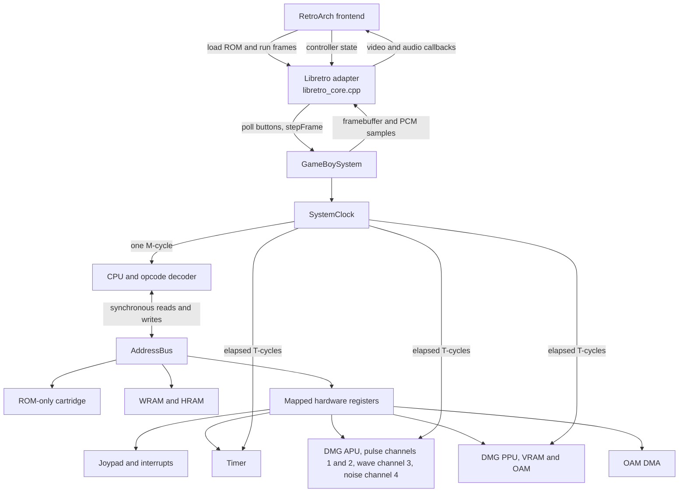

# Current architecture and development workflow

This document describes the implemented emulator, not a target design. Update it when a system boundary or runtime flow changes. Work priorities and milestone status live in the [development roadmap](roadmap.md).

## Current scope

LotusGB currently runs ROM-only DMG cartridges up to 32 KiB. The default system startup skips the boot ROM and initializes a DMG post-boot profile at `$0100`. A CPU-reset profile is available only through `GameBoySystem::createForTest()` for system tests.

The headless system currently combines the CPU, address bus, RAM regions, timer, interrupts, joypad, a partial PPU, OAM DMA, and an initial APU implementation. The APU generates audio for pulse channels 1 and 2, wave channel 3, and noise channel 4. Wave RAM is blocked during active channel 3 playback because the bus model does not yet resolve its narrow access window. Cartridge banking and save persistence, boot-ROM execution, and more complete PPU/APU timing are not implemented.

## Runtime flow

`retro_run()` polls input, advances the system by one frame, then submits video and audio. `SystemClock` asks the CPU to execute one M-cycle. The CPU's bus accesses happen synchronously during that step; after the CPU reports elapsed T-cycles, the clock advances the timer, APU, and PPU by that amount. A zero-time CPU step does not advance system time or peripherals.

`GameBoySystem` owns the hardware components. `AddressBus` routes CPU accesses to mapped regions and borrows those regions; the system keeps them alive. RetroArch callbacks and lifecycle handling stay in the libretro adapter, outside CPU and hardware components.

## Main code boundaries

| Area | Location | Responsibility |
| --- | --- | --- |
| CPU and instruction execution | `src/lib/GBCPU.cpp`, `src/lib/decoder.cpp`, `src/lib/instSubFunc*.cpp` | Execute instructions in M-cycle steps and report memory accesses, flags, and CPU state. |
| System composition and clock | `src/lib/game_boy_system.cpp`, `src/lib/system_clock.cpp` | Own and connect hardware, initialize the default post-boot profile, and advance components from CPU time. |
| Memory and hardware | `src/lib/address_bus.cpp`, `src/lib/memory_region.cpp`, `src/lib/timer.cpp`, `src/lib/dmg_apu.cpp`, `src/lib/dmg_ppu.cpp`, `src/lib/dmg_oam_dma.cpp` | Implement mapped memory regions and DMG devices. |
| Frontend adapter | `src/libretro/libretro_core.cpp` | Load supported content, poll RetroArch input, run frames, and deliver video/audio callbacks. |
| Tests and test ROMs | `src/unit_test/`, `tests/roms/` | Check observable component, system, rendering, and frontend behavior. |

## Development workflow

1. Pick a bounded behavior from the [roadmap](roadmap.md) and state what an external observer should see: registers, flags, cycles, memory accesses, interrupts, pixels, audio samples, or input response.
2. Check the relevant hardware reference and existing test ROMs. Record model and boot assumptions when a ROM depends on them.
3. Add a focused regression at the narrowest useful boundary, then implement the behavior in its owning CPU or hardware component. Keep frontend-specific code in the libretro adapter.
4. Run `make test` and `make build`. Run GBIT or a targeted ROM when it covers the changed behavior; investigate disagreements against hardware behavior.
5. Update the roadmap when milestone status, known limits, or implementation order changes. Update this document when ownership or runtime flow changes.

`make test` covers the in-repository unit and libretro adapter tests. GBIT integration is a separate check; see the repository's development notes for its local setup and the CI workflow for the pinned revision.
