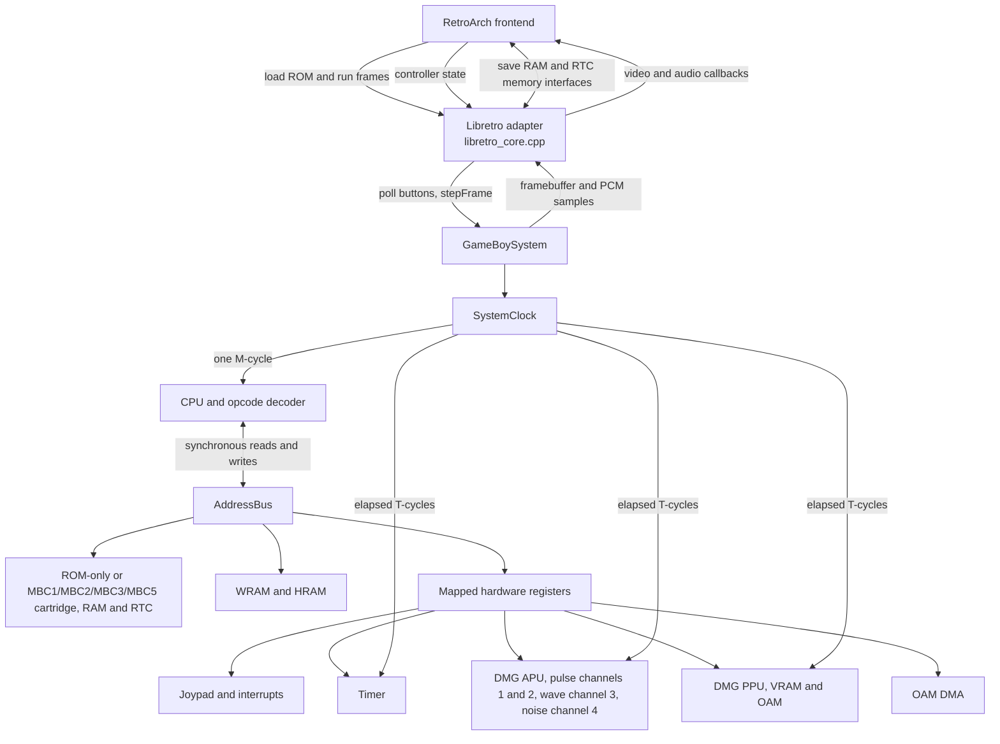

# Current architecture and development workflow

This document describes the implemented emulator, not a target design. Update it when a system boundary or runtime flow changes. Work priorities and milestone status live in the [development roadmap](roadmap.md).

## Current scope

LotusGB currently runs ROM-only DMG cartridges up to 32 KiB, MBC1 types `$01`–`$03`, MBC2 types `$05`–`$06` with up to 256 KiB of ROM and built-in 512×4-bit RAM, MBC3 types `$0F`–`$13` with up to 2 MiB of ROM and 32 KiB of external RAM, and MBC5 types `$19`–`$1E` with up to 8 MiB of ROM and 128 KiB of external RAM. MBC2 battery RAM is exposed as 512 bytes, one nibble per byte; reads return `$F` in the unspecified upper nibble as a deterministic model choice. MBC3 timer types `$0F` and `$10` implement the five RTC registers, latch behavior, HALT, and the 9-bit day counter. The clock catches up against host wall time on RTC access, including time while the frontend is paused or closed. Its versioned 24-byte state is exposed through libretro's RTC memory interface; the frontend owns disk persistence. MBC5 rumble cartridges are supported for banking, but the motor output is not exposed. MBC30-sized RAM and other mapper types are not supported. Battery-backed cartridge RAM uses libretro's save RAM memory interface. The default system startup skips the boot ROM and initializes a DMG post-boot profile at `$0100`. A CPU-reset profile is available only through `GameBoySystem::createForTest()` for system tests.

The headless system currently combines the CPU, address bus, RAM regions, timer, interrupts, joypad, a partial PPU, OAM DMA, and an initial APU implementation. The PPU prepares background/object color indices at mode 3 entry and emits pixels over the visible 160-dot interval, applying BGP/OBP palettes as each pixel is emitted. Mode 3 starts from 172 dots, adds `SCX & 7` fine-scroll dots, adds six dots when the window emits visible pixels, and stalls at object fetch positions for the documented DMG 6–11-dot penalties. Mid-mode-3 tile-fetch/register changes are not modeled yet. The APU generates audio for pulse channels 1 and 2, wave channel 3, and noise channel 4. LotusGB schedules CPU bus transactions at the end of each four-T-cycle M-cycle. This phase passes the current selected Mooneye PPU/interrupt timing ROMs and Blargg CH3 test 09; other bus-sensitive tests should be rechecked as coverage grows. Other cartridge mappers, boot-ROM execution, and more complete PPU/APU timing are not implemented.

## Runtime flow

`retro_run()` polls input, advances the system by one frame, then submits video and audio. `SystemClock` asks the CPU to execute one M-cycle. On the first bus access during the step, it advances the timer, APU, PPU, and OAM DMA through four T-cycles before dispatching the transaction. A step without a bus access advances all reported T-cycles after the CPU step. The timer sends the APU a clock event when divider bit 12 falls, including when a DIV write resets that bit from high to low; the APU uses this to clock its frame sequencer. A zero-time CPU step does not advance system time or peripherals.

DMA is a separate bus master. `AddressBus::read()`/`write()` advance to the CPU
bus phase and then consult the borrowed `ICpuBusArbiter`. The DMA device uses
`readForDma()` to dispatch source reads without re-entering CPU timing or CPU
arbitration. FF46 schedules a transfer; the shared clock moves one byte per
M-cycle after the startup delay. CPU OAM reads return `$FF` while DMA owns OAM;
HRAM and I/O remain accessible, including FF46 for restarting the transfer.
The basic DMG conflict model distinguishes VRAM from the shared cartridge/WRAM
bus: CPU reads on the occupied bus see the latest DMA byte, and CPU writes to
that bus are discarded. Write-induced corruption and PPU/DMA rendering
contention are not implemented. This is DMG behavior, not a CGB bus model.

`GameBoySystem` owns the hardware components. `AddressBus` routes CPU accesses to mapped regions and borrows those regions; the system keeps them alive. RetroArch callbacks and lifecycle handling stay in the libretro adapter, outside CPU and hardware components.

## Main code boundaries

| Area | Location | Responsibility |
| --- | --- | --- |
| CPU and instruction execution | `src/lib/GBCPU.cpp`, `src/lib/decoder.cpp`, `src/lib/instSubFunc*.cpp` | Execute instructions in M-cycle steps and report memory accesses, flags, and CPU state. |
| System composition and clock | `src/lib/game_boy_system.cpp`, `src/lib/system_clock.cpp` | Own and connect hardware, initialize the default post-boot profile, and advance components from CPU time. |
| Memory and hardware | `src/lib/address_bus.cpp`, `src/lib/cartridge.cpp`, `src/lib/memory_region.cpp`, `src/lib/timer.cpp`, `src/lib/dmg_apu.cpp`, `src/lib/dmg_ppu.cpp`, `src/lib/dmg_oam_dma.cpp` | Implement mapped memory regions, ROM-only/MBC1/MBC2/MBC3/MBC5 cartridges, cartridge RAM, and DMG devices. |
| Frontend adapter | `src/libretro/libretro_core.cpp` | Load supported content, poll RetroArch input, run frames, and deliver video/audio callbacks. |
| Tests and test ROMs | `src/unit_test/`, `tests/roms/` | Check observable component, system, rendering, and frontend behavior. |

## Development workflow

1. Pick a bounded behavior from the [roadmap](roadmap.md) and state what an external observer should see: registers, flags, cycles, memory accesses, interrupts, pixels, audio samples, or input response.
2. Check the relevant hardware reference and existing test ROMs. Record model and boot assumptions when a ROM depends on them.
3. Add a focused regression at the narrowest useful boundary, then implement the behavior in its owning CPU or hardware component. Keep frontend-specific code in the libretro adapter.
4. Run `make test` and `make build`. Run GBIT or a targeted ROM when it covers the changed behavior; investigate disagreements against hardware behavior.
5. Update the roadmap when milestone status, known limits, or implementation order changes. Update this document when ownership or runtime flow changes.

`make test` covers the in-repository unit and libretro adapter tests. GBIT integration is a separate check; see the repository's development notes for its local setup and the CI workflow for the pinned revision.
