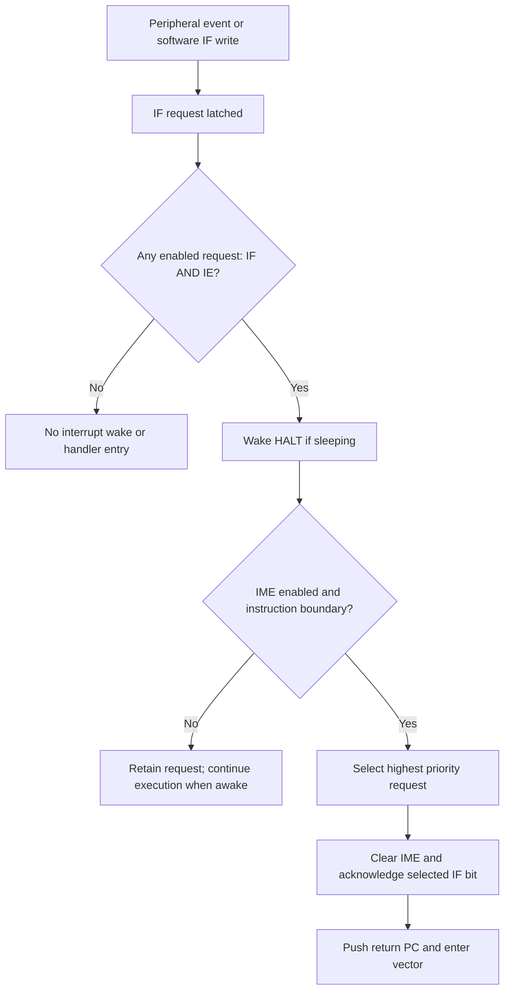

# DMG interrupt behavior and validation

This is the interrupt contract and implementation audit for LotusGB, as of
2026-10-24. It separates hardware rules from current implementation evidence.
Passing instruction tests does not establish peripheral-to-CPU timing accuracy.

## Request, wake, and service

`IF` (`$FF0F`) records requests; `IE` (`$FFFF`) selects enabled sources.
IME gates handler entry. Pending requests are `IF & IE & $1F`; peripherals
can set IF while IME or IE is clear. A request bit is a latch, not a count.
Software may also write IF. Multiple requests use the following priority:

| Priority | Bit / mask | Source | Vector | LotusGB request producer |
| --- | --- | --- | --- | --- |
| 1 | 0 / `$01` | VBlank | `$0040` | PPU |
| 2 | 1 / `$02` | LCD STAT | `$0048` | PPU combined STAT signal and DMG VBlank-entry event |
| 3 | 2 / `$04` | Timer | `$0050` | Timer overflow reload |
| 4 | 3 / `$08` | Serial | `$0058` | Serial hardware is not implemented; IF can be requested manually |
| 5 | 4 / `$10` | Joypad | `$0060` | Selected joypad input-line falling edge |

This diagram describes HALT, not STOP. It omits subcycle races during entry.

## CPU rules

The hardware rules below follow [Pan Docs: Interrupts](https://gbdev.io/pandocs/Interrupts.html)
and [HALT](https://gbdev.io/pandocs/halt.html).

- Game entry at `$0100` has IME clear.
- DI disables service; EI enables it after the following instruction completes.
- RETI restores PC and enables interrupts. RET alone does not enable them.
- Accept interrupts between complete instructions; a CB prefix and its opcode
  belong to one instruction.
- Entry clears IME and the selected IF request, pushes the return PC, and
  vectors in five M-cycles. Stack writes store the high byte first.
- HALT wakes on an enabled pending request, including with IME clear. With
  IME clear and a request already pending when HALT executes, the HALT bug
  suppresses the next opcode-fetch PC increment.

A CPU M-cycle is four T-cycles. The five-cycle entry duration is not by itself
proof of the exact HALT wake phase or intra-cycle IF acknowledgement timing.

## Current implementation and evidence

| Area | Current model | Evidence / limitation |
| --- | --- | --- |
| Startup | `GameBoySystem` post-boot profile sets IME=0. Synthetic CPU reset retains its existing IME=1 convention. | `testPostBootInterruptsWaitForEi` requests IF/IE before EI, checks no handler/stack change, then checks handler execution and return. Synthetic reset is test infrastructure, not a hardware power-on claim. |
| IF / IE | `InterruptRegisters` latches low-five-bit requests; IF reads upper bits high. IE stores its byte. Request generation is independent of IME. | CPU and system tests exercise software requests and real timer/PPU requests. |
| EI / DI | CPU defers EI until the next instruction completes; DI cancels a pending enable. | `testEiDelay` includes a multi-cycle following instruction and an already-pending request. |
| Entry / priority | CPU selects the source at acceptance, acknowledges it immediately, then performs two idle M-cycles, two stack writes, and the vector fetch. | `testInterruptEntryPriorityStackAndVector` checks all five steps, return address, stack order and preservation of another IF bit. Priority changes and acknowledgement races during entry remain unverified. |
| Prefetch / CB | CPU compensates for its prefetched opcode when saving the return address. It does not accept an interrupt between CB bytes. | `testInterruptWaitsUntilCbInstructionCompletes`. Prefetch compensation is internal bookkeeping; software must see the correct return PC. |
| RETI | The instruction restores PC and enables IME. | System handler-return tests, including timer/HALT and post-boot EI. Back-to-back pending service after RETI needs a dedicated regression. |
| HALT | CPU idles while the shared clock advances peripherals. Pending IF/IE wakes it; IME decides whether to enter a handler. | `testHaltWakeAndHaltBug`, `testStopDecodeAndHaltIdle`, and `testTimerInterruptWakesHaltAndRunsHandler`. Exact wake/entry phase is still under investigation. |
| STOP | CPU exposes a separate stopped state with zero elapsed CPU T-cycles; explicit wake resumes fetching. | CPU STOP tests and system frame-step exit coverage. Automatic joypad wake and full hardware STOP behavior are not implemented. |
| Peripheral timing | Timer, PPU and joypad own request generation; CPU owns selection/service. | Component tests plus system integration. Serial transfer completion remains unsupported. |
| Bus phase | `SystemClock` advances components to the end of an M-cycle before a CPU bus access. | Existing CPU bus-access tests and external timing ROMs. This is a model with limited validation, not a guarantee for every register conflict. |

CPU tests are in `src/unit_test/cpu_instruction_test.cpp`; system tests are in
`src/unit_test/game_boy_system_test.cpp`. The implementation boundaries are
`GBCPU`, `InterruptRegisters`, `SystemClock`, and each peripheral.

## STAT-specific behavior

STAT sources share one interrupt signal. Clearing IF while that signal stays
high does not create a new rising edge. Switching between active sources can
therefore block another request. The mode field, readable LY, LYC comparison,
and memory-access windows need not change on the same dot.

LotusGB now has public-interface tests for combined-source blocking, LCD-off
LYC retention, LCD-enable transitions, and the Mode 2 source event at VBlank
entry while the reported mode is 1. External evidence includes:

- [`stat_irq_blocking`](https://github.com/Gekkio/mooneye-test-suite/blob/main/acceptance/ppu/stat_irq_blocking.s)
- [`stat_lyc_onoff`](https://github.com/Gekkio/mooneye-test-suite/blob/main/acceptance/ppu/stat_lyc_onoff.s)
- [`vblank_stat_intr-GS`](https://github.com/Gekkio/mooneye-test-suite/blob/main/acceptance/ppu/vblank_stat_intr-GS.s)
- LCD-enable read/write timing ROMs and the selected Mode 2/Mode 0 timing ROMs.

These selected ROMs pass; this does not cover every STAT-write glitch,
line-153 transition, or interrupt-source race. See [the validation matrix](dmg-validation.md)
for commands and current results.

## Open audit and investigation order

1. **SCX / HBlank timing conflict.** The original SCX ROM still fails its
   SCX=0 boundary after correcting startup IME. An extra HALT wake M-cycle
   makes it pass but breaks five existing PPU timing ROMs, so that experiment
   was discarded. Capture request time, HALT wake, entry cycles, vector code,
   and final LY bus-read time against the same clock before changing behavior.
2. **EI combinations.** Add focused coverage for EI followed by EI, and
   EI followed by HALT with pending and later-arriving requests. In particular,
   the return-PC behavior of EI/HALT must not be inferred from ordinary HALT.
3. **Entry races and RETI.** Check changing IE/IF during the stack writes,
   cancellation/reprioritization of requests, and another request immediately
   after RETI. The current acceptance-time selection is not proof of these cases.
4. **Peripheral-specific gaps.** Add evidence for STAT-write glitches and
   line-153 behavior when working on those PPU features. Implement STOP wake
   and serial events with their corresponding system components.

Items 2–4 are coverage gaps, not confirmed bugs or prerequisites for all other
emulator work. Choose an item when a reproducer or active feature needs it.

For a fix, keep the chain of evidence: hardware expectation → reproducer →
public-interface assertion → external regression. CPU instruction comparison,
component tests, and real-ROM integration answer different questions; retain
all relevant evidence instead of adjusting one subsystem to satisfy one ROM.

## Previous failures and what they taught us

| Incident | Layer | Guard against recurrence |
| --- | --- | --- |
| Interrupt accepted between CB bytes | CPU instruction boundary | Complete-prefixed-instruction regression |
| Wrong IME at skipped-boot entry | System startup | Pending IF/IE before EI system test |
| LYC comparison recomputed while LCD off | Peripheral request generation | Retained-flag and edge-history tests |
| Missing Mode 2 STAT event at VBlank | Peripheral event / shared signal | Entry-dot, blocking, and external DIV-based timing checks |
| SCX passes only after an extra HALT cycle | Cross-component timing, unresolved | Keep the conflicting ROM results; do not retain the experimental delay |

## Bounded SCX timing experiment (2026-10-24)

Four isolated library builds varied only the CPU bus-access phase and an
experimental extra IME-enabled HALT wake M-cycle. Production sources and
core behavior were not changed by the matrix run. Each build ran the same
14 unmodified Mooneye ROMs from `mts-20240926-1737-443f6e1`.

| Bus access phase within M-cycle | Extra HALT wake M-cycle | Passes / 14 | SCX / HBlank | Additional failures relative to current model |
| --- | --- | --- | --- | --- |
| End of T4 (current) | 0 | 12 | FAIL | None |
| End of T3 | 0 | 9 | FAIL | Mode 2→3, Mode 2→0, OAM access timing |
| End of T4 | 1 | 8 | PASS | Five existing PPU mode/interrupt timing cases |
| End of T3 | 1 | 11 | PASS | Mode 1→2 and Mode 2→0 interrupt interval |

The sprite timing ROM fails in all four builds. There is no uniformly better
setting in this matrix. Keep the current model and defer further SCX tuning
until there is new independent evidence, a more discriminating reproducer,
or a game compatibility issue. The result does not identify which subsystem
is ultimately wrong, nor does it show that interrupt handling is fully accurate.
Local experiment sources, logs and per-ROM reports are under
`build/timing-matrix/`; they are ignored build artifacts.
